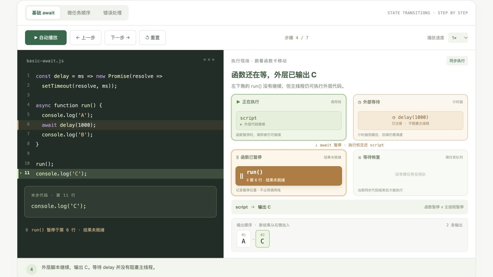

# Lab · 技术知识库

中文技术笔记与交互教程。

**[在线浏览 →](https://l-x-r.github.io/lab/)**

## 目录

### JS
- [看懂 async / await](https://l-x-r.github.io/lab/js/async-await/)：交互教程，逐步执行、微任务、错误处理、串行与并发对比、小测验（`js/async-await/`）

### 数据库
- [PostgreSQL 18 设计规则手册](https://l-x-r.github.io/lab/db/postgresql/)：15 条表结构设计规则，附检查查询与测试脚本（`db/postgresql/`）

### AI
- 暂无



## 结构

- `index.html`：知识库首页（目录）。
- 按领域分目录（`js/`、`db/`、`ai/`），每篇文章一个子目录，入口是其中的 `index.html`，单文件、无需构建。
- `db/postgresql/lab/`：PostgreSQL 手册的测试脚本与原始结果，用法见其中的 `README.md`；页面由 `build_page.py` 生成。
- `docs/`：README 用图片。
- `.github/workflows/pages.yml`：部署到 GitHub Pages。已发布 `js/` 和 `db/`；新增领域目录（如 `ai/`）时，在 “Prepare static site” 步骤的 `cp -R js db _site/` 里加上它。

## 本地浏览

```sh
python3 -m http.server 8000
```

然后访问 `http://localhost:8000`。

## 部署

推送到 `main` 后由 GitHub Actions 自动部署（Pages 的发布来源设置为 **GitHub Actions**）。工作流固定使用 `ubuntu-24.04`，官方 Actions 固定到已验证版本的提交。

## 说明

- async / await 教程的执行现场使用确定性的教学步骤，演示时间不代表实际耗时；“暂停区”是便于理解的示意，并非引擎中的独立队列。
- PostgreSQL 手册中的数据来自单机测试，只看倍数和量级，绝对耗时请在自己的环境复测。
