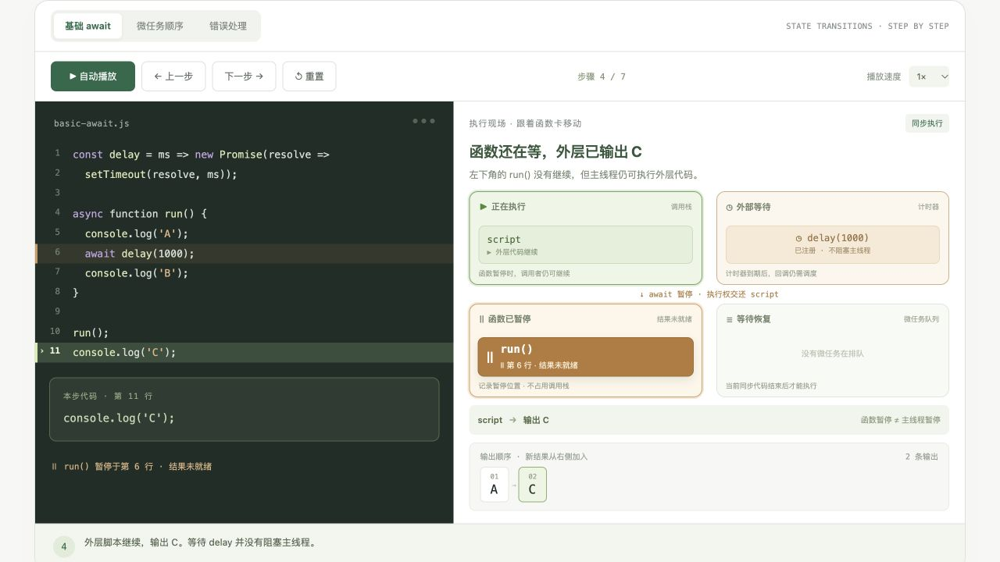

# Async Lab · 看懂 async / await

一个中文 JavaScript 异步交互教程，通过代码高亮、函数卡移动和输出日志，展示 `async / await` 的执行过程。

**[在线体验 →](https://l-x-r.github.io/async-await-lab/)**



## 内容

- 理论导读：Promise 的状态、async 返回值、await 暂停与恢复、微任务调度。
- 三个可逐步执行的场景：基础 await、微任务顺序、错误处理。
- 执行现场：同一张函数卡在执行区、暂停区、微任务队列之间移动，标明外层脚本何时继续。
- 支持自动播放、暂停、调速、单步前进、回退和重置。
- 串行与并发对比：调整两个独立任务的耗时，观察等待时间如何重叠。
- 输出顺序小测验与常见问题。
- 响应式布局，支持桌面和手机；为减少动态效果的系统偏好提供适配。

## 本地浏览

直接用浏览器打开 `index.html` 即可，无需安装依赖或构建。

也可以在仓库目录启动静态服务器：

```sh
python3 -m http.server 8000
```

然后访问 `http://localhost:8000`。

## GitHub Pages

通过 `.github/workflows/pages.yml` 发布。推送到 `main` 分支后会自动部署，也可以在 Actions 页面手动运行。Pages 的发布来源设置为 **GitHub Actions**。

工作流固定使用 `ubuntu-24.04`，并将官方 Actions 固定到已验证版本的提交。上传组件使用支持 Node.js 24 的版本，避免旧版 Node.js 和 `ubuntu-latest` 镜像迁移提示。

- `index.html`：页面内容、样式与交互逻辑，完整保存在单个文件中。
- `.github/workflows/pages.yml`：打包并部署静态页面。
- `.nojekyll`：直接发布静态文件。
- `docs/preview.png`：README 预览图。

## 演示边界

执行现场使用确定性的教学步骤，演示时间不代表程序的实际运行耗时。“暂停区”只是便于理解的状态示意，并非 JavaScript 引擎中的独立队列。串行与并发部分使用理想计时模型，不计调度和网络开销。
